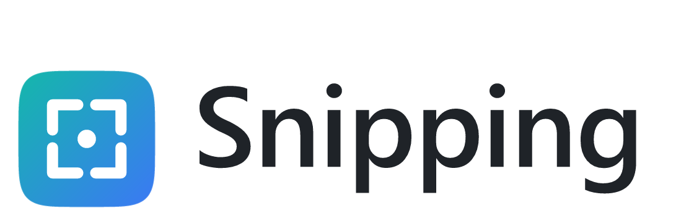

<p align="center">
  <picture>
    <source media="(prefers-color-scheme: dark)" srcset="docs/header-dark.png">
    
  </picture>
</p>

<h3 align="center">Capture, annotate, pin and record your screen.</h3>

<p align="center">
  <a href="#features">Features</a> ·
  <a href="#download">Download</a> ·
  <a href="#build">Build</a> ·
  <a href="#files-and-settings">Files and settings</a> ·
  <a href="#licence">Licence</a>
</p>

Snipping is a fast screenshot and screen-recording tool for Windows.

## Features

- **Capture**: freeze the screen, pick a region, window or monitor, with a magnifier and colour picker. A second shortcut can capture the capture screen itself, for example to show the toolbar.
- **Annotate**: rectangle, ellipse, arrow, pen, highlighter, mosaic, text, numbered markers, eraser, undo and redo.
- **Save**: PNG, JPEG or WebP (lossless WebP too).
- **Pin**: keep an image on top of other windows; zoom, rotate, flip, change opacity, copy or save it.
- **Record**: record a region as GIF, animated WebP or MP4 (H.264, using the graphics card when it can). Set the frame rate, size, quality, mouse pointer, countdown and maximum length on the recorder bar or in Settings.
- **Convert**: convert many images at once. Reads PNG, JPEG, WebP, AVIF, JPEG XL, GIF, TIFF, BMP, ICO, HEIC/HEIF, JPEG 2000, PSD, SVG and camera RAW. Writes PNG, JPEG, WebP, GIF and ICO, including animated GIF and WebP. Keeps 16-bit and HDR detail in PNG and wide-gamut colour profiles in PNG, JPEG and WebP.
- **Explorer menu**: right-click pictures to convert them, or the background of a folder to capture or record the screen.
- **Look**: dark, light or follow Windows.

Every action has a keyboard shortcut that you can change or turn off in Settings > Hotkeys.

## Download

Get `Snipping-<version>-windows-x64.zip` from the Releases page, unzip it anywhere and run `Snipping.exe`. There is no installer.

## Build

Needs Windows 10 or 11, Rust 1.99 or newer and the MSVC build tools. The build script compiles the overlay shader to Direct3D bytecode with the D3DCompiler that ships with Windows and builds the shell icon index with MakePri from the Windows 10 SDK.

```
cargo build --release --locked
```

The program is `target/release/Snipping.exe`.

## Explorer menu on Windows 11

Windows 11 only puts apps with a package identity in its new right-click menu. Snipping has no installer, so it registers a small package that points at the folder of `Snipping.exe` (see `src/shell_pkg.rs`). The package is not signed, so Windows accepts it only while Developer Mode is on (Settings > System > For developers). Without Developer Mode the entry is under "Show more options". Settings > General > Explorer menu switches it between Off, Modern and Classic.

## Files and settings

- Settings are in the `data` folder beside `Snipping.exe` (`data\config.txt`), or in a folder you choose in Settings. Only a chosen folder is remembered in `data\Snipping.location`; the default `data` folder needs no pointer, and moving the application folder therefore moves its settings too. Keep a chosen settings folder out of places other users can write to.
- Recordings in progress are kept in `%LOCALAPPDATA%\Snipping\tmp` until they are saved.
- Files handed over by the Explorer menu pass through `%TEMP%\snipping-requests`.
- The Explorer menu adds entries under `HKCU\Software\Classes`. On Windows 11 with Developer Mode, it is a per-user package whose files are in `%LOCALAPPDATA%\Snipping\shellext`. Set the menu to Off before deleting Snipping.
- Start with Windows adds a `Snipping` value under `HKCU\Software\Microsoft\Windows\CurrentVersion\Run`.

Snipping keeps no logs and makes no network connections.

## Licence

Copyright (C) 2026 sriaro.

Snipping is free software under the GNU Affero General Public License, version 3 only (AGPL-3.0-only). See [LICENSE](LICENSE).

Snipping also carries an additional term under section 7(b) of the AGPL: whoever copies, modifies or distributes it must keep the copyright notice and the author attribution "sriaro" in the source, the documentation and the legal notices, and must mark modified versions as modified. See [NOTICE](NOTICE).

Snipping links the codecs `heic`, `zenwebp` and `zenavif` (with `rav1d-safe`), which are available under AGPL-3.0-only or a commercial licence, so the whole program is under the AGPL. Camera RAW support uses the LGPL crates `imagepipe`, `rawloader` and `multicache` (`imagepipe` is built from a copy in `vendor/imagepipe`, modified on 2026-10-28: its manifest no longer enables the `image` crate's default features, and the source comments, tests, converter binary and README were removed), and `zenavif-parse` is under MPL-2.0. All other dependencies use permissive licences such as MIT, Apache-2.0, BSD, Zlib or ISC. The notices of every linked package are in [THIRD-PARTY-NOTICES.txt](THIRD-PARTY-NOTICES.txt).

This repository is the complete source code of the program.
